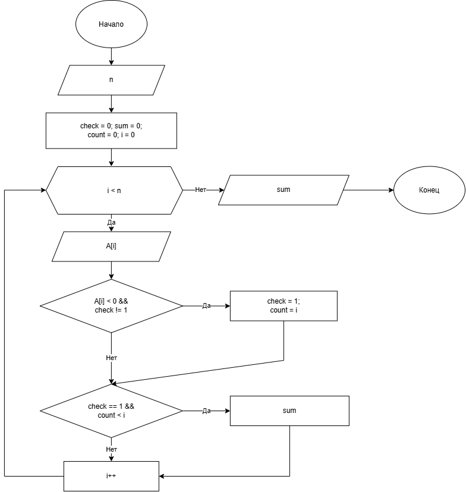

# Домашнее задание к работе номер 11

## Условие задачи

В одномерном массиве, состоящем из n вводимых с клавиатуры положительных и отрицательных целых чисел, найти сумму модулей элементов после первого отрицательного элемента.

## 1. Алгоритм и блок-схема

### Алгоритм

1. Начало.

2. Объявить переменную **n** - размер одномерного массива.

3. С помощью цикла for записать вводимые значения в массив и вычислить сумму модулей после первого отрицательного элемента.

4. Конец.

### Блок-схема



## 2. Реализация программы

```c
#define _CRT_SECURE_NO_WARNINGS
#include <stdio.h>
#include <locale.h>
#include <stdlib.h>
#define N_MAX 100

int main(void) {
    int n;
    int check = 0, sum = 0, count = 0;
    setlocale(LC_CTYPE, "RUS");
    printf("Введите n: ");
    scanf("%d", &n);
    int A[N_MAX];
    for (int i = 0; i < n; i++) {
        printf("Введите элемент A[%d]: ", i);
        scanf("%d", &A[i]);
        if (A[i] < 0 && check != 1) {
            check = 1;
            count = i;
        }
        if (check == 1 && count < i) {
            sum += abs(A[i]);
        }
    }
    printf("Сумма модулей после 1-го отрицательного элемента: %d\n", sum);
    return 0;
}
```

## 3. Результаты работы программы

Пример:\
 \
Введите n: 5\
Введите элемент A[0]: 1\
Введите элемент A[1]: 2\
Введите элемент A[2]: -3\
Введите элемент A[3]: 4\
Введите элемент A[4]: -5\
Сумма модулей после 1-го отрицательного элемента: 9

## 4. Информация о разработчике

Литуновский Максим Дмитриевич, бТИИ-261
